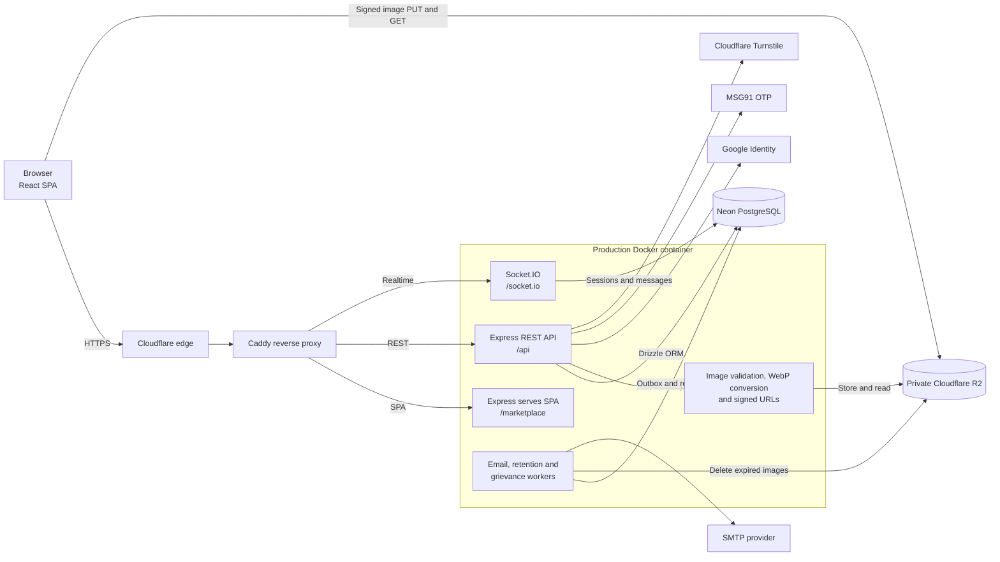

# Uni Market

A mobile-first independent marketplace where eligible adult students can buy and sell used physical products, communicate privately, and complete offline exchanges. Any verified Google account may sign in; marketplace actions additionally require a separately verified student email from the reviewed academic-domain registry, an explicit 18+ declaration, and current policy acceptance. Phone verification is an optional trust signal.

Uni Market is not affiliated with, endorsed by, sponsored by, or operated by any university, college, or educational institution. Institution names and email domains are used only to verify eligibility.

The application is a TypeScript npm workspace with a Vite/React frontend, Express/Socket.IO API, Drizzle data layer, Neon PostgreSQL connections, a PGlite fallback for isolated local/test runs, and a private Cloudflare R2 image pipeline.

## Architecture



The React app lives in `apps/web`, the API and workers in `apps/api`, and shared schemas and types in `packages/shared`. See [docs/architecture.md](docs/architecture.md) for the data model and critical flows.

## Prerequisites

- Node.js 22 or later and npm 10+
- Chromium for Playwright (`npx playwright install chromium`)
- For production: Neon PostgreSQL, a private R2 bucket, Google OAuth credentials, MSG91 OTP Widget credentials, SMTP, and Cloudflare Turnstile

## Local setup

```bash
cp .env.example .env
npm ci
npm run db:migrate
npm run db:seed
npm run dev
```

Open `http://localhost:5173`. The API listens at `http://localhost:4000`. Use the isolated Neon staging database for shared development, or `DATABASE_URL=pglite://.data/marketplace` for a disposable local database.

Set `DEV_MODE=true` locally to disable external SMS/email delivery and accept only `999999` for both phone and student-email OTPs. The API logs that development mode is active without logging the code. The configuration validator refuses to start when `NODE_ENV=production` and `DEV_MODE=true`.

Google sign-in requires `GOOGLE_CLIENT_ID` in the API and `VITE_GOOGLE_CLIENT_ID` in the web build. There is no password or email-OTP fallback in production code.

## Database and seed commands

```bash
npm run db:generate
npm run db:migrate
npm run db:seed
```

For Neon, set `DATABASE_URL` to the pooled connection string. Run migrations against a development branch first, inspect the generated SQL in `apps/api/drizzle`, and only then target production. The seed creates baseline categories and prohibited terms. `BOOTSTRAP_ADMIN_EMAILS` promotes matching users to `SUPER_ADMIN` when they first complete Google sign-in; it is never exposed through public registration.

## Development and production commands

```bash
npm run dev
npm run lint
npm run typecheck
npm run test:unit
npm run test:integration
npm run test:e2e
npm run build
npm run test:all
npm run start -w @campus-market/api
```

The production frontend is in `apps/web/dist` and is served at `/marketplace`; `/` redirects to that product path. The API entry point is `apps/api/dist/index.js`, and `/api`, `/socket.io`, and `/health` remain at the origin root. Serve everything behind TLS, keep `CLIENT_URL` set to the exact origin without a path, and set `TRUST_PROXY=true` only behind a trusted single proxy.

The included production container builds both applications, serves the SPA from Express, runs database migrations before startup, and exposes only port `4000` inside the container. On the shared deployment droplet, Compose binds it to `127.0.0.1:3020` and Caddy uses the isolated site fragment in `infra/uni-market.caddy`. Application logs are capped at three 10 MiB Docker files. Uni Market's Caddy access log rolls at 10 MiB and keeps no more than three rolled files or seven days, whichever removes a file first.

Pushes to `main` deploy only after both CI jobs pass. The deploy job uses a dedicated forced-command SSH key and a root-owned deployment bootstrap, validates Compose, keeps a rollback image until the new container is healthy, removes only the superseded Uni Market image, and prunes unused build cache older than seven days. It never performs a global image, container, or volume prune on the shared droplet.

For Google Identity Services, configure `http://localhost`, `http://localhost:5173`, and `https://uni.rocks` as Authorized JavaScript origins. The `/gsi/transform` document is Google's private button iframe and must not be configured as an application redirect URI. Uni Market explicitly uses popup mode and receives the credential through its JavaScript callback.

## R2 uploads

Draft image uploads use a short-lived signed PUT URL to a random temporary key. Finalization verifies ownership, byte size, actual JPEG/PNG/WebP signature, dimensions, and configured limits; Sharp re-encodes the image as WebP and strips metadata. The temporary object is deleted. Pending images remain private and read URLs are short lived. When R2 credentials are absent outside production, an equivalent signed local storage adapter supports development and tests.

Production uses the private `uni-market` bucket and [infra/r2-cors.json](infra/r2-cors.json). Local development uses the separate private `uni-market-staging` bucket and [infra/r2-cors.staging.json](infra/r2-cors.staging.json), whose browser access is limited to `http://localhost:5173`. Set the `R2_*` variables only in the API environment; never expose R2 keys through `VITE_*` variables.

## Listing moderation

Every seller listing starts as a private draft. A verified seller uploads and previews images, then submits to `PENDING`. Only a moderator or super admin can approve it. Approval changes moderation to `APPROVED` and lifecycle to `ACTIVE`; rejection/request-changes records visible feedback; removal is distinct from sale and withdrawal. Material edits return approved listings to `PENDING` and hide them. Every staff decision is audited.

Read [docs/moderation-policy.md](docs/moderation-policy.md) before moderating content.

## Production safety

- Use separate, random session and CSRF secrets; rotate compromised sessions.
- Keep `DEV_MODE=false`; production validation also rejects PGlite and missing Google, OTP, R2, and Turnstile settings.
- Restrict R2 CORS and application CORS to the deployed frontend origin.
- Use a dedicated Neon test branch for hosted integration runs.
- Configure the Cloudflare limits in [docs/security.md](docs/security.md).
- Run `npm audit --omit=dev`, all tests, and the production build before release.
- SMTP and email outbox processing are asynchronous; monitor failed jobs.

Additional documentation: [architecture](docs/architecture.md), [API](docs/api.md), [security](docs/security.md), [testing](docs/testing.md), and [UI references](docs/ui-reference.md).

Before any production release, complete the [India compliance operations runbook](docs/compliance-operations.md) and obtain qualified legal review of the public policies and configured statutory details.
